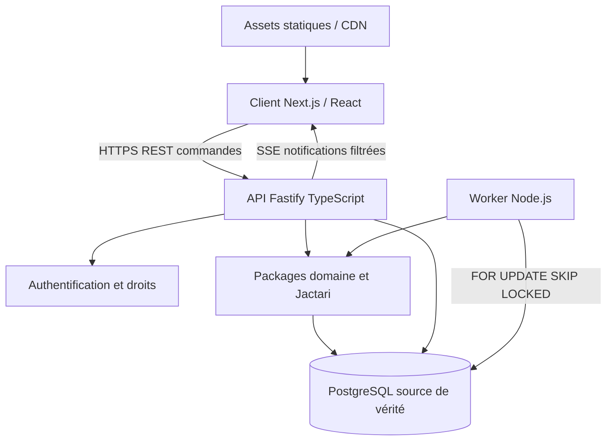

# ADR-001 — Stack cible de MMHK-like (PROPOSITION, décision non encore validée)

**Date :** 27 octobre 2026  
**Statut :** `proposed` — **aucune décision technologique finale du porteur de projet n'a été recueillie**.  
**Périmètre :** futur jeu navigateur multijoueur persistant, PvP, alliances, Guerre des Larmes, carte torique.  
**Distinction indispensable :** stack **déjà présente** vs stack **recommandée** ci-dessous.

## 1. Historique et état vérifié

Les échanges et les fichiers du dépôt ont fixé le périmètre de gameplay, la
référence MMHK saison 2, le premier prototype Havre T1–T3, la restitution des
vues isométriques par navigateur et la primauté de la logique serveur.

**Ils n'ont PAS validé de framework frontend, de serveur d'API, de SGBD
de production, de middleware de travail distribué ou de stratégie de déploiement.**

Le dépôt à cette date contient :
- `tools/jactari-port/` : modules ECMAScript natifs `.mjs`, oracles Jactari,
  géométrie, héros, batailles et laboratoire de missions ;
- `node:sqlite` avec `DatabaseSync`, les états de missions et des
  transactions dans `trusted-hero-store.mjs` ;
- `node:test` et GitHub Actions sous Node 22 pour les tests ;
- utilitaires Python pour les sources, captures et assets ;
- **aucun frontend Next/React, serveur Fastify/Symfony, projet TypeScript
  structuré, conteneur applicatif, schéma PostgreSQL, auth réseau ni serveur
  de jeu multijoueur de production.**

Ces éléments relèvent d'un **laboratoire technique**, pas d'un choix définitif.

## 2. Proposition de stack

| Couche | Recommandation | Rôle |
| --- | --- | --- |
| Langage applicatif | **TypeScript** | Types communs, modèle métier et protocoles, compilation / contrôle strict |
| Frontend navigateur | **Next.js + React** | Connexion, ville, région, carte, rapports, inventaire, alliances |
| Rendu visuel | **DOM/CSS et images positionnées**, Canvas 2D/PixiJS optionnel | Fidélité aux vues historiques ; optimisation ciblée de la carte |
| Backend du jeu | **Node.js + Fastify (TypeScript)** | API HTTP autoritative, sessions, permissions, commandes |
| Moteur de simulation | **Packages TS indépendants des frameworks** | Calcul des ressources, missions, combats Jactari, héros, événements |
| Base de données autoritative | **PostgreSQL** | Monde persistant, transactions, état militaire, isolation par monde, audit |
| Ordonnancement | **Process worker Node.js indépendant**, file d'échéances PostgreSQL | Jobs échus, reprise et idempotence ; pas de combats par ordonnanceur générique |
| Notifications | **SSE** initialement, WebSockets à la demande | Actualiser la carte, notifications d'arrivée, chat futur |
| Cache / bus | **Redis facultatif, ultérieur** | Accélération et diffusion éphémère ; jamais source de vérité |
| Fichiers médias | Stockage statique versionné / CDN ; S3/MinIO selon besoins | Sprites, illustrations, rapports joints |
| Déploiement | **Docker Compose sur VPS avec reverse proxy**, CI GitHub Actions | Développement reproductible, API + workers maintenus en permanence |
| Observabilité | Logs structurés, métriques, traces et alertes | Diagnostic des incidents d'ordonnancement et intégrité métier |

**Pourquoi cette combinaison ?** Le moteur historique adapté est déjà
JavaScript sans DOM : rester dans l'écosystème Node facilite sa réutilisation
en déplaçant progressivement les interfaces métier vers TypeScript. Un
MMO asynchrone a surtout besoin de **transactions fiables et d'horloges
serveur**, pas d'un moteur temps réel de type FPS.

### Choix à différer

- **PixiJS** : seulement si les scènes très denses de la carte gagnent
  objectivement à passer en Canvas/WebGL. Les archives 4.1.3-MTR
  attestent pour les villes un fond et des bâtiments GIF positionnés par CSS.
- **Redis/BullMQ** : non requis pour V1. La file persistée PostgreSQL
  simplifie l'atomicité des échéances militaires. Redis pourrait servir
  plus tard aux notifications non critiques, verrous éphémères ou caches.
- **WebSockets** : non requis pour que l'économie ou les déplacements
  avancent en serveur. Les états sont datés et calculés côté serveur.
  SSE suffit au départ pour les notifications.
- **Microservices / Kubernetes** : non justifiés pour le premier monde.
  Préférer un monolithe modulaire avec un worker exécutable séparément.

## 3. Architecture logique



Les joueurs ne transmettent jamais comme vérité : vitesse, date d'arrivée,
coût de recrutement, puissance d'un héros, propriétaire du territoire,
règle de combat, modification diplomatique, ou fin de mission.

L'API valide l'acteur et la commande, puis le domaine et le stockage
autoritaires calculent et appliquent la transition dans une transaction.
Le client reçoit un snapshot filtré selon ses droits de visibilité et
affiche les mouvements à partir de dates et d'événements déjà validés.

## 4. Organisation du dépôt proposée

```text
apps/
  web/                  Next.js / React / UI
  api/                  Fastify, auth, commandes, API REST / SSE
  worker/               échéances militaires, économie, notifications
packages/
  domain/               entités, règles et commandes pures
  combat/               moteur Jactari isolé + adaptateurs typés
  contracts/            schémas validés de requêtes / événements
  persistence/          SQL PostgreSQL et dépôts
  ui/                   composants d'interface réutilisables (si utiles)
tools/
  jactari-port/         laboratoire historique actuel, CONSERVÉ
  ...                   récupérations, fixtures, comparateurs
docs/
  decisions/            ADR, preuves, décisions validées
```

Monorepo avec workspaces pnpm, compilation contrôlée par TypeScript strict,
ESLint et tests Node ; un outillage de test d'intégration PostgreSQL
doit compléter le banc Jactari existant.

**Ne pas réécrire le moteur de combat uniquement pour des raisons
d'organisation.** Définir un port/adaptateur typé autour du code expérimental,
maintenir des tests différentiels historiques, puis migrer par modules
lorsque cela apporte un bénéfice mesurable.

## 5. Propriétés non négociables du multijoueur

1. **PostgreSQL est la seule vérité métier** (positions, propriétaires,
   ressources, armées, dates, batailles, résultats, dépenses).
2. Transactions par commande ; clé idempotente, journal d'événements et
   révisions métier ; contrôle serveur systématique.
3. `FOR UPDATE` / contraintes / unicité pour les changements d'état ;
   `FOR UPDATE SKIP LOCKED` pour répartir **uniquement** les travaux
   de queue concurrents, pas pour choisir le vainqueur d'un combat.
4. Baux de workers et contrôles de génération/fencing lors du **commit**.
5. Réconciliation après crash sans double prélèvement, double décès
   ou double transfert de propriété.
6. Visibilité de la carte et des héros filtrée par droits et espionnage.
7. Chaque monde/campagne porte son identifiant ; la concurrence n'introduit
   jamais d'opérations entre mondes.
8. Aucune règle Ubisoft saison 2 supposée n'est promue en production
   sans profil de politique et preuve explicites.

## 6. Migration de SQLite à PostgreSQL : ne pas faire un copier-coller

`node:sqlite` sert actuellement à éprouver une transaction.
Les garanties de verrouillage SQLite (`BEGIN IMMEDIATE`) ne se
transposent pas mécaniquement aux transactions PostgreSQL.

Créer des adaptateurs de persistance et des tests d'équivalence sur les
**invariants** et les **transitions**, notamment les états de rappel V12,
la géolocalisation, les collisions de missions, la protection débutant,
les incidents, l'idempotence et l'audit. Garder SQLite pour les oracles
du laboratoire tant que les suites différentielles le nécessitent.

Ne pas utiliser la migration V11 → V12 SQLite comme une migration
PostgreSQL : écrire de nouveaux schémas SQL contrôlés et rejouables,
puis importer les fixtures pertinentes.

## 7. Deux alternatives sérieuses examinées

- **Symfony/PHP + Next.js** : excellente option si l'on privilégie
  la productivité et les compétences existantes en Symfony. Elle
  imposerait néanmoins un service Node isolé pour réutiliser directement
  l'écosystème Jactari et complexifierait l'intégration synchrone
  du moteur militaire aux transactions principales.
- **NestJS/TypeScript + Next.js** : alternative cohérente, plus structurante
  par conventions et injection de dépendances, mais plus lourde à initier.
  Fastify monolithique modulaire reste le choix recommandé pour V1.

Aucun de ces compromis ne constitue une décision validée tant que l'ADR
n'a pas été approuvée par le porteur du projet.

## 8. Paliers d'adoption proposés

**A — Prouver la stack :** squelette monorepo, liveness API, page Next.js
de démonstration et connexion PostgreSQL. Aucune mécanique historique
modifiée.

**B — Premier chemin métier vertical :** compte/session, monde,
première ville, snapshot filtré, une construction et son événement à
échéance, rendu 2D fidèle ; transaction et test de bout en bout.

**C — Raccorder Jactari :** module `packages/combat`, interface typée,
tests de fidélité existants inchangés ; commandes PvE/PvP d'abord
dans un laboratoire sécurisé.

**D — Ordonnancement et PvP :** persistance PostgreSQL des missions,
reprise des workers, gestion des collisions, rappel et tests de concurrence ;
les combats PvP historiques restent verrouillés tant que les preuves S2
et la sécurité ne sont pas suffisantes.

**E — Jeu progressif :** économie Havre T1–T3, carte, sites/reliques,
alliances et Guerre des Larmes par tranches jouables et démontrables.

## 9. Garde-fous juridiques

Les adaptations historiques Jactari/MMHK-Plus portent des mentions
GPL-3.0-or-later ; une revue spécifique du périmètre dérivé, des
obligations de redistribution et des licences des sprites récupérés
est indispensable avant diffusion du code ou exploitation publique.
Le fait de posséder des fichiers archivés ne confère pas automatiquement
un droit de redistribution des images Ubisoft.

## 10. Critères d'approbation de l'ADR

Valider explicitement : TypeScript + Next.js, API Fastify, PostgreSQL,
worker Node, rendu DOM/CSS avant Canvas, monorepo, hébergement Docker/VPS,
et stratégie de migration progressive des outils Jactari.
Jusqu'à cette approbation : **statut PROPOSED** ; éviter de créer
un backend définitif présenté comme choisi.
