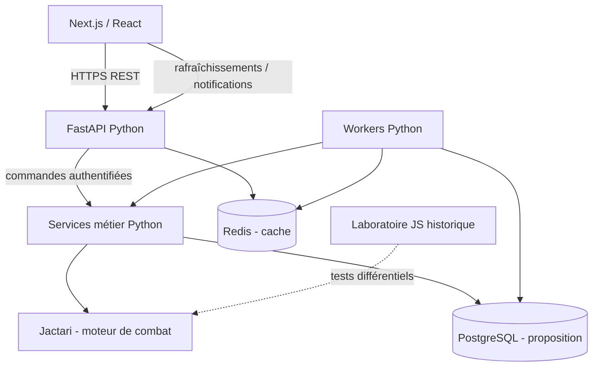

# ADR-001 — Architecture applicative de MMHK-like

**Date :** 27 octobre 2026  
**Statut :** `accepted_partial` — choix exprimés par le porteur du projet, autres éléments proposés à confirmer.  
**Périmètre :** jeu navigateur de stratégie multijoueur persistant, carte torique, PvP et Guerre des Larmes.

## 1. Décisions effectivement exprimées

Le porteur du projet a retenu explicitement :
- **Backend : Python + FastAPI**, exposant une API REST autoritative.
- **Frontend : React + Next.js**, pour les vues et interactions du jeu.
- **Workers :** traitements de fond séparés, à prévoir dès la conception.
- **Redis :** cache serveur, avec politique d'invalidation et limites de cohérence.
- **Nom du moteur de combat : Jactari** (respecter strictement cette graphie).

Il n'a **pas encore arrêté explicitement** le SGBD, la bibliothèque de workers, le choix du système d'authentification, l'outil de rendu de carte ou la plateforme de déploiement. Ces choix restent des recommandations, pas des validations tacites.

## 2. Situation réelle du dépôt au 27 octobre 2026

- `tools/jactari-port/` contient le **laboratoire historique Jactari** en JavaScript/ES Modules, ainsi que les tests différentiels, le calcul de combat, la géographie, les missions et le stockage SQLite expérimental.
- Les tests sont exécutés avec `node --test` et GitHub Actions sous Node 22.
- Des outils Python servent à la rétroconception et à la collecte d'archives.
- **Il n'existe pas encore d'application FastAPI, de frontend Next.js, de serveur PostgreSQL, de Redis connecté ni de workers en service dans ce dépôt.**
- Le laboratoire actuel ne doit pas être présenté comme un jeu multijoueur déployé.

La priorité est de faire entrer progressivement le laboratoire dans la stack choisie, sans réécriture prématurée des preuves historiques.

## 3. Architecture cible

| Couche | Technologie | Décision |
| --- | --- | --- |
| Client web | Next.js + React | **Validée** |
| Langage du client | TypeScript | Recommandé |
| API / logique de jeu | Python + FastAPI | **Validée** |
| Modèles d'API | Pydantic | Recommandé |
| Données métier persistantes | PostgreSQL | Recommandé, à confirmer |
| Cache serveur | Redis | **Validé** |
| Worker séparé | Python | Principe validé ; Celery/Dramatiq ou worker SQL à arbitrer |
| Moteur de combat | **Jactari** | **Nom validé** |
| Rendu cartographique | DOM/CSS et images positionnées ; Canvas 2D facultatif | À évaluer |
| Conteneurisation | Docker Compose | Recommandée |
| CI | GitHub Actions | Déjà employée dans le laboratoire |

### Architecture logique



PostgreSQL est recommandé comme **source de vérité unique** pour les armées,
villes, ressources, ordres, saisons et événements. Redis sert au cache et,
éventuellement, à la diffusion ou au courtage des tâches. Une perte de Redis
ne doit jamais détruire une mission ni entraîner le paiement ou l'application
de pertes en double.

Le serveur valide l'identité, la propriété des héros, les droits d'alliance,
la protection débutant, les dates et les règles métier. Le navigateur ne
détermine pas les résultats d'un combat ni les dates faisant autorité.

## 4. Jactari : nom et stratégie d'intégration

**Jactari** est le nom exact du moteur de combat au sein de MMHK-like.

La rétroconception existante en JavaScript conserve une valeur importante :
- code historique Jactari / MMHK-Plus et provenance ;
- tests différentiels avec les sources originales ;
- jeux de données permettant de contrôler calculs, arrondis et ordre des phases.

Pour une intégration **native au backend FastAPI**, proposer un paquet Python
`jactari` contenant un noyau de combat pur, déterministe, sans SQL ni HTTP.
Le portage devra être **progressif** et comparé aux tests et oracles JS
conservés. Un résultat non supporté doit être refusé plutôt que substitué
par une approximation. Pendant la transition, une interface de service
isolée peut entourer les calculs JS existants en laboratoire, sans en faire
une dépendance implicite de la production.

**Important :** vérifier la licence GPL-3.0-or-later des adaptations du code
historique, leurs obligations et les droits sur les assets récupérés avant
toute redistribution.

## 5. Workers et fiabilité multijoueur

- Exécuter les traitements longs ou programmés **hors requête HTTP** :
  arrivée des armées, fin de construction, production, rapports et notifications.
- Conserver en base la date d'échéance, les événements et les identifiants
  idempotents ; les workers ne sont que des exécutants.
- Traiter les échéances sous transaction et verrouillage, avec réservation,
  expiration et protection contre les anciens workers.
- Ne pas prendre l'ordre de travail Redis/Celery pour une règle de victoire
  militaire : les collisions d'arrivées nécessitent une politique métier propre.
- Le moteur Jactari ne reçoit que des snapshots métier validés et ne modifie
  pas directement la persistance.

**Choix d'outil de workers restant à faire :** Celery avec Redis, Dramatiq,
ou workers PostgreSQL orientés échéances. La fiabilité des missions doit être
démontrée par des tests de concurrence, de crash et de redémarrage.

## 6. Structure de dépôt proposée

```text
apps/
  web/                 Next.js, React, TypeScript
  api/                 FastAPI, routes REST, authentification, services
  worker/              Entrée de traitement Python hors HTTP
packages/
  jactari/             Moteur de combat Python (après portage vérifié)
  domain/              Règles métier, dataclasses / Pydantic si utile
  persistence/         Modèles et migrations de la base
tools/
  jactari-port/        Laboratoire historique JavaScript CONSERVÉ
docs/
  decisions/           ADR et décisions de stack
```

Cette arborescence est une **proposition de structuration**, pas une application
déjà générée.

## 7. Feuille de route d'adoption

1. Squelette minimal Next.js + FastAPI avec contrat REST et tests d'intégration.
2. Décision explicite sur PostgreSQL, outillage de migration et gestion des sessions.
3. Première tranche jouable : monde, première ville, mines, ressources, construction,
   héros et premier scénario PvE Havre T1–T3.
4. Interface typée `JactariBattleRequest → JactariBattleResult` indépendante du
   transport et de la persistance ; portage Python test par test.
5. Workers Python et Redis pour la mise en cache, l'invalidation et les
   notifications ; calendrier persistant piloté par la base.
6. Portage du cycle militaire et des protections SQLite V7 vers des
   transactions PostgreSQL validées (si cette base est retenue).
7. Déverrouillage éventuel du PvP seulement après revue historique,
   de sécurité, de licence et de charge.

## 8. Ce que l'ADR ne prétend pas établir

- Ni FastAPI ni Next.js ne sont déployés aujourd'hui dans le dépôt.
- Les tests Node existants ne certifient pas les règles serveur Ubisoft S2.
- Le choix de Redis ne transforme pas le cache en stockage fiable des armées.
- Aucun moteur graphique 3D n'est requis a priori.
- Les règles S2 d'interception, trêve et rappel restent partiellement inconnues.
- `productionBattleArbiterAllowed=false` doit rester inchangé.
