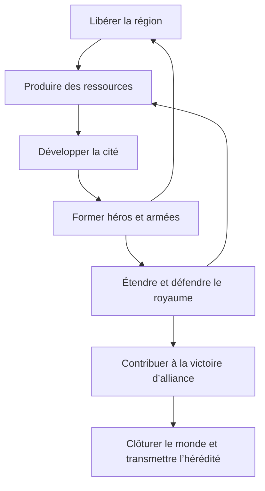

# Game design — identité, boucles et interfaces

## Nature de l’expérience

MMHK est un jeu de stratégie multijoueur asynchrone : un monde partagé continue d’évoluer quand le joueur est déconnecté, mais sa campagne possède une ouverture et une conclusion. Le joueur développe un royaume composé de cités, de héros et d’armées, participe à une alliance et contribue à une victoire collective. La progression intercampagnes relève de l’hérédité, distincte de la conservation du royaume courant. [DOC : SRC-08, SRC-09 ; corpus G01, G26–G28]

Le cœur de l’expérience décrit par la demande et confirmé par les sources repose sur quatre arbitrages : investir dans la production ou dans la guerre ; employer les héros au développement ou les envoyer en mission ; concentrer la puissance ou répartir la présence ; optimiser son classement ou servir l’objectif d’alliance. Ces arbitrages constituent une **analyse de design**, pas quatre règles textuelles retrouvées.

La maîtrise se joue avant les rencontres : information, composition et ordre des pelotons, choix du héros, magie, trajectoire, heure d’arrivée et coordination. Le combat est résolu automatiquement et produit un rapport détaillé. Il n’y a pas, dans ce modèle, de bataille tactique interactive sur un échiquier commandée coup par coup. [COR : SRC-09, CODE-01-COMBAT]

## Les trois échelles

| Vue | Objet manipulé | Questions du joueur | Commandes essentielles |
| --- | --- | --- | --- |
| Monde | Régions de la carte, cités, alliances, influence, trajets et objectifs | Où s’implanter ? Qui peut arriver ? Quelle cible défendre ? | Observer, chercher des coordonnées, sélectionner une cible, envoyer un héros, espionner, piller, assiéger, coloniser |
| Région | Territoire local d’une cité, emplacements, mines, rencontres et aménagements | Quelle zone libérer ? Quelle production améliorer ? Où placer un bâtiment régional ? | Attaquer un groupe PNJ, récupérer une récompense, exploiter/améliorer une mine, construire un aménagement |
| Ville | Bâtiments, ressources, recrues, héros présents et garnison | Que construire ? Que recruter ? Quelle mission préparer ? | Construire/améliorer, recruter et améliorer les unités, recruter/former un héros, commercer, préparer une armée |

La région est décrite comme une grille **5 × 5** avec cité centrale et quatre mines dans la présentation générale ; ce modèle doit être vérifié pour les régions spéciales et les générations de mondes. Une case du monde et un emplacement régional sont deux objets différents. Toutes les cases du monde ne doivent pas être supposées colonisables : obstacles et sites spéciaux exigent une règle d’éligibilité. [DOC : SRC-10 ; distinction de modèle PROP]

## Boucles imbriquées

Cette représentation est une synthèse fonctionnelle. Elle ne fixe ni la cadence économique ni un ordre de tutoriel obligatoire.

**Boucle locale :** libérer les points bloqués par les PNJ, transformer leurs récompenses en investissement, ouvrir des bâtiments et des rangs d’unités, puis résoudre des rencontres plus exigeantes. Les ressources et recrues disponibles n’équivalent pas encore à une armée opérationnelle : les coûts, héros nécessaires et capacités doivent être satisfaits.

**Boucle territoriale :** obtenir le droit de posséder davantage de cités, coloniser ou conquérir, étendre la production et la présence, sécuriser les mouvements et l’approvisionnement. Le développement spatial augmente également les besoins de coordination et de défense.

**Boucle collective :** choisir partenaires, rôles et objectifs, partager l’information autorisée, concentrer les attaques et organiser les défenses, puis gagner une course de fin de campagne dont les règles dépendent du profil du monde.

## Parcours de lecture d’une session — proposition d’interface

À la connexion, le tableau de bord doit présenter les événements écoulés, les actions terminées, les alertes militaires, les ressources plafonnées, les héros libres et les prochains engagements. Le joueur peut ensuite passer directement d’un rapport à sa région, de la région à la ville, puis de la ville à une mission sur la carte. La navigation doit conserver le contexte de cité et l’heure serveur.

Avant un ordre coûteux, afficher cible, héros, armée, coût, durée, heure d’arrivée estimée, effet de la trêve et conditions susceptibles d’invalider l’ordre. Une estimation ne doit pas être présentée comme une garantie lorsque l’influence, la diplomatie ou la cible peuvent changer. Après validation, l’action apparaît dans une file horodatée et produit une trace à son achèvement.

## Ce qui doit rester fidèle avant toute variation

| Pilier | Engagement de reconstruction proposé | Référence détaillée |
| --- | --- | --- |
| Persistance temporelle | Les ordres progressent hors connexion ; les heures réelles comptent | Domaine et temps |
| Développement local | Cité, région libérable, production, coûts et prérequis | Économie |
| Asymétrie militaire | Lignées T1–T7, améliorations, armes et magie par faction | Héros et armées ; catalogues |
| Préparation des combats | Pelotons ordonnés, héros, sorts programmés, rapport reproductible | Combat |
| Logistique | Durées, frontières, haltes, trêve, approvisionnement | Carte et PvP |
| Dépendance collective | Alliances et progression vers une condition de victoire commune | Alliances et fin de monde |
| Campagne finie | Clôture explicite et progression intermondes distincte | Hérédité |

Le futur changement d’univers pourra remplacer noms, images et récit sans imposer un changement des formules. Les modifications de rythme, d’entretien, de monétisation ou de victoire seront enregistrées comme décisions de design du successeur, et non présentées comme une restitution du jeu original.
