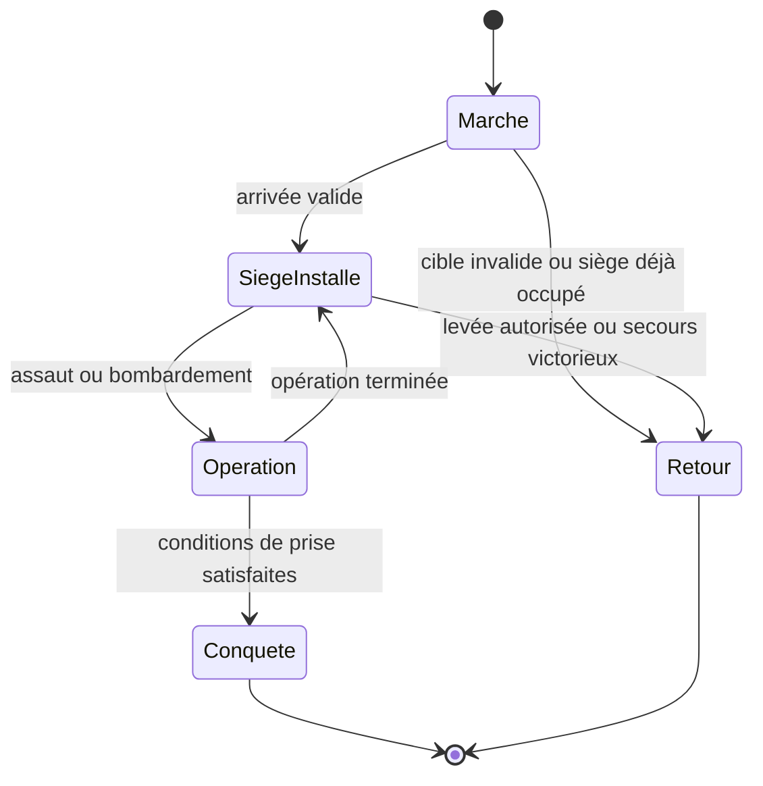

# Carte, déplacements, information et guerre territoriale

## Géométrie et estimation de distance — OBS-CODE

Dans `mmhkplusUtilities.js`, la distance est euclidienne sur une carte carrée à bords raccordés :

```text
dx = abs(x2 − x1) ; si dx > taille/2 : dx = taille − dx
dy = abs(y2 − y1) ; si dy > taille/2 : dy = taille − dy
distance = sqrt(dx² + dy²)
```

Les coordonnées sont ramenées dans l’intervalle 1…taille par une fonction de modulo. C’est une preuve du modèle employé par l’outil, pas du détail du trajet serveur traversant chaque région. Ne pas remplacer cette distance par Manhattan sans justification. [CODE-01-DIST]

L’estimateur affiche `distance/12` heures pour un héros seul, `distance/4` pour une armée et `distance/9,375` pour une caravane. Ces durées ignorent ici haltes, trêve et bonus : elles ne constituent pas une heure d’arrivée opérationnelle. Le trajet d’une armée de siège doit avoir ses propres paramètres.

## Haltes, territoires et trêve — DOC

G05 décrit une halte de deux heures après huit points de mouvement en territoire neutre ou hostile, soit approximativement quatre cases ; ces huit points demandent une heure avec armée, deux en siège. Le territoire allié évite les haltes ordinaires. Départ et retour ont des compteurs distincts ; la route est déterminée au départ. Une trêve nocturne prolonge les interruptions : un reste de halte peut reprendre après la nuit. Le guide donne 23 h–9 h dans son contexte russe ; ce n’est **pas** un horaire validé pour les serveurs français. Il faut retrouver fuseau, transitions et règles en Guerre des Larmes. [G05]

### Contrat de trajet proposé

Le planificateur doit retourner les segments, la relation territoriale rencontrée, les arrêts, les temps d’attente de trêve, les bonus appliqués et l’heure d’arrivée calculée. Conserver le plan initial et la règle de recalcul. La modification d’une alliance ou la prise d’une cité pendant le trajet ne doit pas déclencher une décision implicite du code : chaque événement doit avoir une politique définie dans le profil.

Les demandes de rappel, la poursuite d’une cible disparue, le changement de propriétaire et l’arrivée simultanée de plusieurs armées sont des états de mission, pas des erreurs réseau. Leur comportement historique exact reste à compléter.

## Espionnage — DOC

G15 distingue reconnaissance de troupes et inspection plus complète de cité/région via Rôdeur. Niveau du héros, compétences, équipement et temps consacré influent sur la qualité. Les rapports peuvent révéler progressivement identité, niveau, carrière, talents, objets et sorts. Une détection peut laisser l’éclaireur anonyme, le blesser en révélant son identité ou conduire à sa capture avec les capacités appropriées. Le guide donne une XP de `min(100 + XP_du_meilleur_héros_adverse/100, 10 000)`. Les probabilités et seuils de qualité ne sont pas reconstitués. Un rapport doit donc porter son instant d’observation et son degré d’information, sans donner automatiquement l’état actuel intégral de l’adversaire. [G15 ; contrat de rapport PROP]

## Pillage — DOC

G06 décrit une montée du rendement de pillage avec la puissance : 50 000 pour 20 % de production quotidienne, 250 000 pour 100 % sur la cible et une fraction dans les zones adjacentes, 1 250 000 pour le rendement adjacent maximal. Les mines subissent une indisponibilité indiquée de 24 heures. La cible exacte, les plafonds du butin, son transport et les modificateurs doivent être vérifiés sur la version choisie. La même source décrit une diplomatie PvE de recrutement conditionnel de créatures de même faction, mais les probabilités restent à recouper. Ces mécanismes ne sont pas assimilés au siège, dont la finalité est la conquête. [G06]

## Siège et capture — DOC, synthèse de G10

Le guide impose un emplacement de cité disponible, exclut les alliés et la dernière cité d’un joueur actif, et exige au moins 50 % de la force adverse. Il indique un minimum de douze heures et des opérations de quatre heures empêchant une levée immédiate. Un seul assiégeant est retenu ; les suivants repartent. Le blocus limite déplacements et caravanes, empêche de nouvelles constructions mais laisse finir celles engagées, et autorise le recrutement. La défense sélectionne jusqu’à sept pelotons puissants. La prise conserve la faction et les ressources de la cité, disperse les troupes et peut capturer le héros.

Pour le bombardement : résistance `1,5 × coût_or × poids`, poids recrutement 1, magie 0,8, fortification 1,2, autres 0,8 ; baliste 500, catapulte 2 000. Les cibles sont aléatoires dans une catégorie, sans dommage partiel indiqué. Des réductions par encerclement et Graals sont décrites, mais leur cumul reste incertain. [G10]

## États fonctionnels du siège — proposition à confronter au jeu



Le diagramme décrit les états à gérer ; il ne résout pas à lui seul les conditions historiques de victoire, d’attrition ou d’annulation. Les renforcements, sorties, attaques de secours, héros prisonniers, rançons, protection des débutants et inactivité doivent être spécifiés avant ouverture PvP publique.

## Rapports militaires et droits d’information

Une attaque doit produire un rapport avec départ, arrivée, cible, forces connues, héros, lieu, sort par tour, dispersions, morts, XP, butin, bâtiments détruits et événements de capture. La vue du propriétaire, de l’adversaire et des officiers d’alliance peut différer. Les détails obtenus par reconnaissance ne doivent pas devenir des données publiques via une API de carte. Cette exigence est une proposition de reconstruction cohérente avec l’existence d’espionnage et de rôles d’alliance, et non une reproduction démontrée du protocole historique.

## Renseignements ajoutés par les captures

**OBS-IMAGE :** SS-031 expose les trois cibles de reconnaissance — troupes, ville, région — ainsi qu’un curseur de durée, un temps et une valeur d’information. Le couple 4 h 34 min 28 s / 130 est un point de mesure, insuffisant pour retrouver une formule de qualité ou de capture. SS-026/037 montrent un héros en prison distante, sans les modalités de libération.

SS-041 distingue une cible principale de pillage et des cibles secondaires, une durée estimée de dégâts et du butin inconnu. Les temps 19 h 33 min 30 s et 3 h 54 min 42 s ont ici un rapport de cinq ; cela ne prouve pas un coefficient universel sans connaissance des caractéristiques et cases. Les « ? » sont des informations manquantes, pas un butin nul.

Les trajets pointillés et les frontières sont visibles sur le monde. Les captures ne déterminent ni la distance parcourue réellement, ni la vitesse, ni la gestion des diagonales. Ces inconnues restent U09 ; le JavaScript du futur client assurera l’affichage et le serveur l’exécution temporelle.
