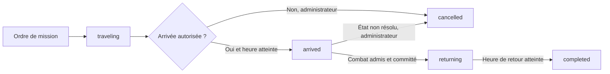

# MMHK-like — V7.0, tranche 2 : missions militaires persistantes et retour des survivants

**26 octobre 2026 · Statut C17 : `implemented_partial` · V7.0 : `in_progress`.**

## Objectif

Relier le moteur transactionnel livré en V7.0 tranche 1 à un **cycle de mission persisté** : réservation d'un héros, trajet, arrivée, engagement autorisé, retour des survivants et libération du héros. L'objectif est d'empêcher des doubles départs, des résolutions prématurées et les pertes appliquées hors d'une mission réellement arrivée.

La modélisation des missions est ici **une politique d'intégrité du projet MMHK-like**, non une transcription certifiée des règles de déplacement d'Ubisoft. Les temps de trajet et les horaires de retour proviennent de **valeurs calculées par un futur planificateur côté serveur**, et **jamais d'une durée inventée dans ce code**. Les blessures/captures, déplacements détaillés et interceptions historiques restent explicitement bloqués.

## 1. Machine d'état



| État | Invariants techniques |
| --- | --- |
| `traveling` | Réservation exclusive du héros attaquant, instantané de sa révision, destination et horaire d'arrivée définis par le serveur ; aucune troupe soustraite lors du départ |
| `arrived` | Heure atteinte, propriété et droits de cible **revalidés**, héros de départ inchangé |
| `returning` | Combat effectivement committé, pertes appliquées aux deux armées dans la transaction du reçu, héros toujours réservé |
| `completed` | Retour autorisé au plus tôt à l'heure fixée par un planificateur fiable ; libération de la réservation |
| `cancelled` | Intervention administrative autorisée sur une mission `traveling` ou `arrived` **sans combat enregistré** ; aucune capture/blessure simulée |

**Point important :** la réservation porte ici sur **le héros attaquant dans son ensemble**, pas sur des sous-détachements ni une simulation géographique. Le héros et son armée restent dans la table `heroes`, mais la progression et les engagements concurrents qui utiliseraient cette force sont refusés. Après le combat, les survivants sont comptabilisés dans l'enregistrement du héros mais **le héros n'est pas disponible tant que le retour n'est pas terminé**.

Le système refuse aussi, par prudence, un engagement contre un héros déjà en mission : les règles d'interception de héros en déplacement n'ont pas été retrouvées. Cette restriction est une **décision de sécurité non historique**, et devra être remplacée par les véritables règles du jeu.

## 2. Persistance SQLite

La [couche `trusted-hero-store.mjs`](../../tools/jactari-port/trusted-hero-store.mjs) contient désormais deux tables supplémentaires :

```text
military_missions
  mission_id          PRIMARY KEY
  actor_player_id     FK players
  attacker_hero_id    FK heroes
  defender_hero_id    FK heroes
  status              traveling | arrived | returning | completed | cancelled
  arrival_at_ms       entier (millisecondes UTC)
  attacker_revision   entier (révision figée au départ)
  return_at_ms        entier nullable
  battle_command_id   FK battle_commands, unique, nullable

military_mission_events
  mission_id          FK military_missions
  sequence            entier, clé avec mission_id
  event_json          événement JSON
```

Un index unique partiel `one_active_mission_per_attacker` interdit deux missions du même héros dans les états `traveling`, `arrived` ou `returning`. Les transactions `BEGIN IMMEDIATE` sérialisent les opérations et garantissent que **chaque changement d'état et chaque événement d'audit** est committé ensemble.

### Journal des opérations

L'audit contient, dans l'ordre : `dispatched`, `arrived`, `battle_committed`, `return_scheduled`, `return_completed`. Une annulation utilise `administratively_cancelled`. Le rejeu idempotent ne crée **pas** de deuxième événement. Un rollback du combat annule aussi son événement de transition : la mission reste `arrived`.

## 3. APIs livrées

Le nouvel adaptateur [`server-military-mission.mjs`](../../tools/jactari-port/server-military-mission.mjs) expose :

- `dispatchServerHeroMission()` : accepte les trois identifiants (mission, attaquant, défenseur), une session authentifiée via un résolveur privé, des droits de cible et un horaire d'arrivée **fourni par le serveur** ; crée la réservation en transaction ;
- `arriveServerHeroMission()` : utilise l'heure fiable du serveur, vérifie la propriété et la cible **à nouveau**, puis effectue `traveling → arrived` ;
- `scheduleServerHeroReturn()` : seulement après un combat committé ; enregistre une date de retour fournie par le serveur (aucune durée de trajet calculée) ;
- `completeServerHeroReturn()` : exige la date échue, clôt la mission et libère la réservation ;
- `cancelServerUnresolvedMission()` : opération **administrative** demandant une politique explicite ; refuse l'annulation d'une mission déjà résolue en combat.

La [commande `commitServerAuthorizedJactariBattle()`](../../tools/jactari-port/server-transactional-battle.mjs) accepte désormais, **en plus de son identifiant idempotent de combat**, un identifiant de mission optionnel `missionId`. Lorsqu'il est présent, SQLite vérifie que :

1. la mission existe, est à l'état `arrived` et lie le même acteur, le même héros attaquant et le même défenseur ;
2. la révision de l'attaquant n'a pas changé depuis le départ ;
3. la cible n'est pas elle-même réservée sur une mission en déplacement ;
4. l'admission Jactari et les règles serveur injectées autorisent l'engagement ;
5. les armées, le reçu, l'événement `battle_committed` et la transition `arrived → returning` **partagent exactement la même transaction d'écriture**.

Un appel **direct hors mission** reste possible pour les anciens scénarios expérimentaux, mais il **ne peut pas engager un héros réservé**. Une clé d'idempotence déjà committée doit conserver le même `missionId` : elle ne peut pas être déplacée vers une autre mission.

### Exemple (pseudo-intégration côté serveur)

```js
const mission = dispatchServerHeroMission({
  command:{missionId:'m-001',attackerHeroId:'a-1',defenderHeroId:'d-2'},
  authContext:serverSession,
  authenticate:serverIdentityResolver,
  authorizeTarget:serverDiplomacyAndWorldPolicy,
  heroStore,
  trustedSchedule:{nowMs:serverClock(),arrivalAtMs:serverCalculatedArrival}
});

// Ultérieurement, après validation par l'horloge serveur :
arriveServerHeroMission({
  command:{missionId:'m-001'},
  authContext:serverSession,authenticate:serverIdentityResolver,
  authorizeTarget:serverDiplomacyAndWorldPolicy,
  heroStore,serverNowMs:serverClock()
});

const battle = commitServerAuthorizedJactariBattle({
  command:{missionId:'m-001',commandId:'fight-001',
    attackerHeroId:'a-1',defenderHeroId:'d-2'},
  authContext:serverSession,authenticate:serverIdentityResolver,
  authorizeTarget:serverDiplomacyAndWorldPolicy,
  heroStore,trustedRules:serverSelectedJactariRules
});

// Ensuite une date de retour fournie par le serveur est enregistrée.
// Le héros reste indisponible jusqu'à completeServerHeroReturn().
```

Cet exemple n'est **pas un endpoint HTTP** : tout callback de validation, de planification et d'accès SQLite appartient exclusivement au serveur. Le navigateur ne peut choisir ni l'heure d'arrivée/retour ni une force militaire différente des données sauvegardées.

## 4. Preuves en CI

Le banc [`server-military-mission.test.mjs`](../../tools/jactari-port/server-military-mission.test.mjs) exerce les transitions suivantes :

- départ, arrivée et retour complets avec combat appliqué atomiquement ;
- refus d'arrivée prématurée et d'une durée d'aller ou retour nulle/négative ;
- impossibilité de réserver plusieurs fois le même héros attaquant, y compris depuis une autre connexion SQLite ;
- interdiction de modifier la progression du héros engagé ou de contourner la mission par un combat direct ;
- révocation de l'autorisation de la cible entre le départ et l'arrivée ;
- interdiction de combattre un héros déjà parti sur une autre mission : interception non couverte ;
- validation de la transition `arrived → returning` dans **la même transaction que les pertes**, avec injection d'une panne juste avant `COMMIT` ;
- journal `military_mission_events` complet, ordonné, durable et sans doublons lors des retries ;
- arrêt/relancement du stockage SQLite entre le départ, le combat, le retour et la clôture ;
- impossibilité de remplacer un `missionId` par un autre pendant le rejeu idempotent du combat ;
- refus de toute capture ou blessure non démontrée et **aucune modification des héros en cas d'admission non résolue** ;
- annulation administrative explicitement validée, sans écriture de conséquences militaires fictives.

Ces tests s'ajoutent aux essais différentiels historiques Jactari, aux contrôles des héros et aux cas d'idempotence de la première tranche V7.0. Le résultat complet de la CI est indiqué par le registre de conformité après vérification.

## 5. Limites à conserver avant un vrai serveur PvP

Il manque **des preuves et des composants métier**, qui ne doivent pas être comblés arbitrairement :

- **Déplacement géographique réel :** position des héros, distance, vitesse des unités, nature du terrain, calendrier et retour selon les règles saison 2 ; le planificateur n'est qu'un contrat injecté ;
- **Missions physiques complètes :** fractions d'armée, garnison et escouades distinctes, interceptions, attaques simultanées, arrivée/retour des détachements ;
- **Admission non-combattante :** capture, blessure, retraite, durée et libération réelle du héros ; seule la branche « combat admis par le Jactari original » applique actuellement les pertes ;
- **Authentification réelle :** comptes, tokens vérifiés, sessions, permission de combat, visibilité de carte, diplomatie et **protection débutant de sept jours** ;
- **Autres conséquences :** expérience, butin, honneur, trophées, sièges, résurrection serveur, arrivées différées ;
- **Infrastructure :** service HTTP, migrations reproductibles, reprise d'opérations distribuées, validation sous forte concurrence et versions de règles S2 prouvées indépendamment.

La mise à disposition d'un **mécanisme transactionnel de mission** n'implique pas la conformité historique de ce mécanisme. Cette tranche construit un squelette de fonctionnement sûr, pas un clone certifié des missions MMHK saison 2.

## 6. Statut et suite

**V7.0 : en cours. C17 : `implemented_partial`. C18 : `blocked_source`. `productionBattleArbiterAllowed=false`.**

La prochaine tranche devrait d'abord exploiter les **sources de déplacements et de missions récupérées** (interfaces de trajets, ordres d'attaque, captures, retours, unités/garnisons) pour distinguer les règles S2 effectivement attestées de nos choix de fiabilisation. Ensuite, modéliser la diplomatie et la protection débutant dans des gardes serveur et les transitions de blessure/capture prouvées historiquement, avant de connecter un serveur réseau accessible aux joueurs.
