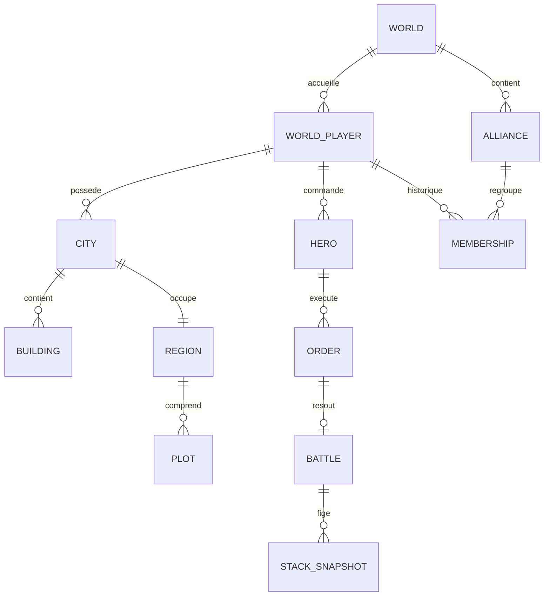
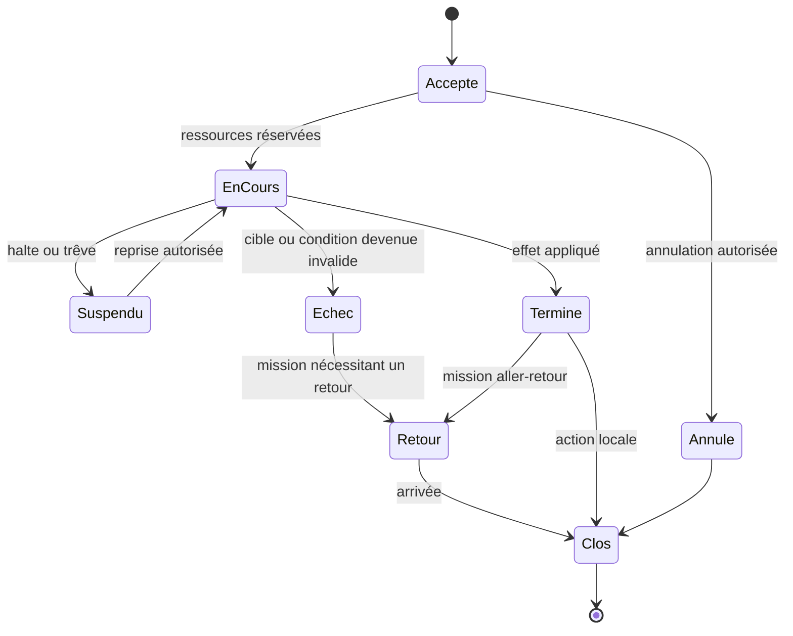

# Modèle de domaine et traitement du temps

**Tout ce document est une proposition d’architecture fonctionnelle.** Aucune affirmation n’est faite sur la technologie du serveur Ubisoft. Le but est de rendre les mécanismes reconstructibles, vérifiables et compatibles avec des campagnes persistantes.

## Entités et responsabilités

| Entité | Données essentielles | Invariant principal |
| --- | --- | --- |
| Account | Identité, préférences, droits globaux | Pas de monnaie de monde stockée directement ici |
| World | Profil, catalogue, taille, fuseau, vitesse, ouverture, phase, fermeture | Une règle complète et versionnée par campagne |
| WorldPlayer | Compte, monde, faction initiale, scores, droits de cité | État propre à ce monde |
| Alliance | Monde, chef, membres, rang, score, compétences, objectifs | Membres et relations du même monde |
| Membership | Joueur, alliance, rôle, début/fin | Une appartenance active conforme au profil |
| DiplomacyRelation | Alliances, type, dates et permissions | Une relation de passage ne devient pas une alliance |
| WorldRegion | Coordonnées, terrain, propriétaire/influence, site | Adresse unique dans le monde |
| City | Propriétaire, faction, région, bâtiments, statut de siège | Une cité active par emplacement admissible |
| RegionPlot | Région, position locale, contenu, état de libération | Ville centrale et cases locales distinctes |
| Mine | Ressource, niveau, extension, état, bonus | Source de production, pas un simple coffre |
| BuildingInstance | Définition, niveau/variante, chantier, cité/case | Ancien et nouveau niveaux non cumulés par erreur |
| ResourceAccount | Conteneur, quantités, réserves, date de calcul | Disponibilité = stock moins réserves, jamais négative |
| RecruitPool | Cité, lignée, quantité, production | Une recrue disponible n’est pas déjà une unité achetée |
| Hero | Propriétaire, position, activité, archétype, XP, talents, équipement | Une activité exclusive selon les règles |
| Army / Stack | Commandement, localisation, ordre, type, effectif | Une unité n’est affectée qu’à un seul conteneur |
| ArtifactInstance | Définition, propriétaire, emplacement, liaison | Identité unique, pas de duplication par transfert |
| LearnedSpell | Héros, définition, disponibilité | Recharge distincte du calendrier des tours de combat |
| Order / OrderStep | Type, acteur, cible, état, dates, coût, entrées, résultat | Exécution idempotente et transitions autorisées |
| MovementPlan | Segments, distance, territoire, pauses et ETA | Plan initial distingué des révisions |
| BattleSnapshot / Result | Entrées immuables, version, tours, pertes, XP | Rapport reproductible et versionné |
| Siege | Cité, assiégeant, début, opérations, défense | Une installation active selon le profil |
| TradeOffer / Caravan | Propriétaire, marchandises, prix, état, trajet | Conservation des ressources dans tous les états |
| QuestProgress | Définition, étape, preuve, récompense | Une récompense une fois par droit acquis |
| Tear / Monument | Origine, détenteur, consommation, cité, alliance | Une Larme ne finance qu’un monument |
| WorldResult / LegacyGrant | Classements, barème, avantages, attribution | Résultat final immuable et attribution unique |

Le modèle n’impose pas une table SQL par ligne : il fixe la responsabilité et l’identité de chaque objet. Les référentiels `UnitDefinition`, `BuildingDefinition`, `SpellDefinition`, `HeroArchetype`, `TalentDefinition` et `ArtifactDefinition` restent séparés des instances détenues par les joueurs.

## Relations principales



La possession de la région et son influence ne sont pas confondues dans le modèle complet. Les relations affichées sont les principales, pas toutes les cardinalités possibles des renforts et objets.

## Temps et déterminisme

Conserver les horodatages en UTC, et le fuseau de trêve dans le profil du monde. L’heure affichée au joueur peut être locale ; toutes les décisions restent prises sur la même horloge serveur. Le changement d’heure saisonnier et la traversée de minuit doivent être testés avec les règles de trêve retenues.

Une action longue est un ordre persistant, pas un minuteur dans l’onglet. Un ordonnanceur traite les échéances. Le traitement doit pouvoir reprendre après arrêt du service sans perdre un chantier ni créer deux batailles. Si le serveur est indisponible, la stratégie de reprise — simulation des instants passés, gel global ou autre — doit être définie pour le monde et communiquée.

Les événements partageant un même instant logique nécessitent un ordre stable. Proposition de départ : ordonner par `(scheduled_at, priorité_de_règle, identifiant_d’ordre)` ; **la priorité n’est pas encore fixée** pour prise de cité, production, fin de trêve, renfort et victoire. Ces cas sont bloquants pour une qualification fidèle.

## Accumulation des ressources

Le calcul peut être différé : stock à `t0` + production sur `[t0,t1]`, puis consommation et plafonds. Mais un changement de mine, héros, équipement, monument ou siège coupe l’intervalle. Garder les fractions tant que la règle d’arrondi n’impose pas leur perte. Le moteur doit pouvoir expliquer chaque variation : production, recrutement, achat, pillage, récompense, entretien ou remboursement.

Les ressources en transit et celles réservées par une enchère sont des conteneurs distincts. Elles ne doivent pas apparaître simultanément dans le stock disponible du départ et de l’arrivée. Les récompenses dépassant un plafond demandent une politique spécifique ; l’existence d’un courrier de récompense est une piste, pas une solution universelle présumée.

## États d’un ordre



Les durées et transitions permises dépendent du type. « Suspendu » ne doit pas rendre le héros disponible. Une annulation n’implique pas automatiquement un remboursement total ; cette politique attend sa preuve historique.

## Commandes et événements proposés

Une commande exprime une intention (`StartConstruction`, `RecruitUnits`, `DispatchArmy`, `ScoutTarget`, `StartSiege`, `ActivateAllianceSkill`, `BuildMonument`). Elle fournit les identifiants choisis et une clé d’idempotence, jamais un résultat à faire croire au serveur. Le serveur vérifie coûts et préconditions et écrit l’ordre.

Un événement décrit un fait acquis : `ConstructionCompleted`, `ResourceProduced`, `ArmyArrived`, `BattleResolved`, `CityCaptured`, `AllianceMembershipChanged`, `MonumentActivated`, `VictoryWindowBroken`, `WorldClosed`. Les affichages et notifications se fondent sur ces faits. Un événement répété ne doit pas répéter ses effets.

```json
{
  "command": "DispatchArmy",
  "idempotency_key": "client-generated-unique-key",
  "world_id": "world-test-01",
  "hero_id": "hero-42",
  "target_region_id": "region-155",
  "mission": "attack",
  "stacks": [{"unit_definition_id": "reference:0", "count": 100}],
  "spell_plan": [],
  "expected_state_version": 17
}
```

Cet exemple est un contrat proposé, pas un protocole retrouvé. La puissance, le coût et la durée sont recalculés côté serveur. Les identifiants sont illustratifs et ne définissent pas la structure finale de l’API.

## Transactions et concurrence

Les opérations suivantes doivent être atomiques au niveau fonctionnel : réserver héros et troupes ; débiter ressources et créer chantier ; acheter un lot et créditer le vendeur ; consommer une Larme et créer le chantier de monument ; résoudre une bataille et inscrire ses pertes ; prendre une cité et transférer les objets concernés ; clôturer un monde et attribuer l’hérédité.

La prise de verrou doit porter sur les ressources disputées, pas seulement sur l’écran. Deux connexions du même compte peuvent envoyer des ordres en même temps. Deux alliances peuvent arriver au même instant. Une seconde confirmation de paiement de ressource doit retourner le premier résultat, pas relancer l’action.

## Rapports, audit et confidentialité

Chaque rapport de bataille conserve catalogue, règles, entrées, effets par étape, dispersions et pertes finales. Les calculs corrigés ultérieurement doivent pouvoir être comparés au rapport ancien sans le remplacer. Pour un tirage aléatoire, conserver la graine ou une trace de tirage appropriée pour la validation ; ne pas exposer aux joueurs une information permettant de prédire des contenus cachés.

Les API de carte doivent appliquer les mêmes limites de connaissance que l’interface. Les rôles d’alliance ne donnent accès qu’aux rapports autorisés ; les états internes des PNJ ou la réserve ennemie ne sont pas exposés par commodité. Les opérations d’administration sont journalisées. Ces choix protègent l’intégrité du jeu sans prétendre reproduire l’infrastructure historique.

## Opérations d’un monde

Prévoir ouverture, sauvegarde, restauration vérifiée, suspension planifiée, reprise, clôture, export des résultats et archivage en lecture seule. Les métriques utiles sont retard de traitement des ordres, nombre d’effets rejoués, stocks négatifs empêchés, incohérences d’appartenance, rapports impossibles à reproduire et distribution des ressources. Les seuils de charge et objectifs de service seront fixés lors du dimensionnement, pas déduits d’une population historique approximative.

## Compléments issus des écrans — PROP

Séparer `HeroEquipment`, `HeroBackpack` et `CityArtifactInventory` : les trois conteneurs sont visibles dans SS-023, mais leurs capacités et conditions de transfert restent à établir. Une localisation d’objet est exclusive ; la pagination est une présentation, pas une règle de capacité.

Un `ConvoyProgram` représente les réglages de répétition/attente de SS-053, et produit des ordres `ConvoyLeg` individuellement identifiés. Compteur de répétitions, politique de quantité, attente et règle de réservation restent versionnés ; « 4 fois » ne suffit pas à fixer leur sémantique exacte. Interrompre un programme ne supprime pas rétroactivement un trajet déjà parti.

Une mission de reconnaissance porte un périmètre (`troops`, `city`, `region`) et la durée demandée ; le score affiché est issu du calcul serveur. L’état de caméra et les animations JavaScript ne participent pas à la résolution persistante. Voir [interface](INTERFACE-ET-RENDU-ISOMETRIQUE.md).
