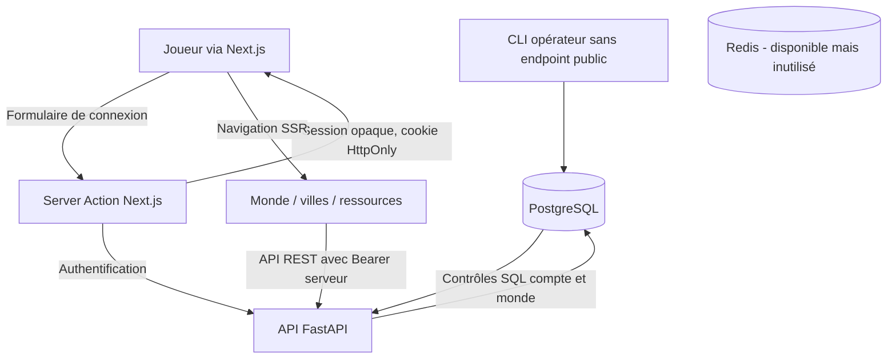

# Première boucle métier · Mondes, villes et ressources

**27 octobre 2026 — livraison technique limitée, non certifiée MMHK S2.**

## Décisions appliquées

Le langage serveur est Python/FastAPI, le frontend Next.js/React et le moteur
de combat se nomme **Jactari**. Le laboratoire Jactari historique Node est
conservé et continue à passer ses tests.

PostgreSQL est **un choix provisoire d'implémentation**, non une nouvelle
décision explicite du porteur du projet.

Pour respecter les décisions P0, le premier Havre est situé dans une région
ayant exactement les quatre mines or, bois, minerai et cristal. Les autres
ressources ont un stock en ville, mais pas de mine initiale ; aucune quantité
de départ, fréquence de crédit ou formule économique n'est supposée connue.

## Chaîne fonctionnelle

Schéma PostgreSQL créé par
[`apps/api/src/mmhk_api/sql/001_initial.sql`](../../apps/api/src/mmhk_api/sql/001_initial.sql) :
`accounts`, `sessions`, `worlds`, `world_memberships`,
`cities`, `city_stocks`, `city_mines`, et registre de migration.

L'API **ne propose aucun compte auto-inscrit ni commande d'écriture métier**.
La création d'un compte et d'une première ville est une commande d'opérateur
effectuée hors HTTP. Les requêtes de villes sont filtrées par propriétaire
et appartenance au monde dans SQL, sans transmettre les ressources des
adversaires.

### États réels, pas historiques

- Le monde est persistant dans PostgreSQL.
- La ville possède une position, une identité et un statut de première ville.
- Les **stocks sont explicitement initialisés à 0**, jamais simulés au hasard.
- Les mines initiales sont définies selon P0 pour Havre.
- La production est désactivée et son résultat `historical_economy_certified`
  vaut `false`.
- Pas de protection de sept jours active dans cette API : la protection
  débutant existe dans un laboratoire JS distinct, sans migration autorisée.
- Aucun combat n'est exposé. La conformité Jactari et MMHK S2 n'est pas déduite
  de ce premier affichage.

## Sécurité et suite

Avant de proposer la création de compte en ligne, il faudra
authentification vérifiée et sécurisée, rate limiting, anti-abus,
réinitialisation, politique de sessions, contrôles d'autorisation
et HTTPS sur un environnement de préproduction.

Le laboratoire économique et la production périodique devront être portés
sans inventer les quantités ni le rythme de la saison cible.
Redis pourra accélérer des lectures non sensibles après établissement
d'une politique d'invalidation fondée sur les versions de PostgreSQL,
mais les stocks restent lus dans le SGBD dans cette tranche.

Un worker Python autoritatif et durable sera développé pour les échéances,
puis les constructions, le recrutement et les missions, avec les contrôles
transactionnels de concurrence déjà étudiés en JavaScript.

## Démarrage et tests

Se référer à
[`apps/api/README.md`](../../apps/api/README.md)
pour l'exécution locale et les prérequis. Les tests d'intégration réels
vérifient le cloisonnement par compte, le refus de consultation
des villes étrangères, la validité/expiration des sessions et
la migration SQL idempotente.

**Statut jeu : expérimental. Aucun déploiement public ni ouverture PvP.**
